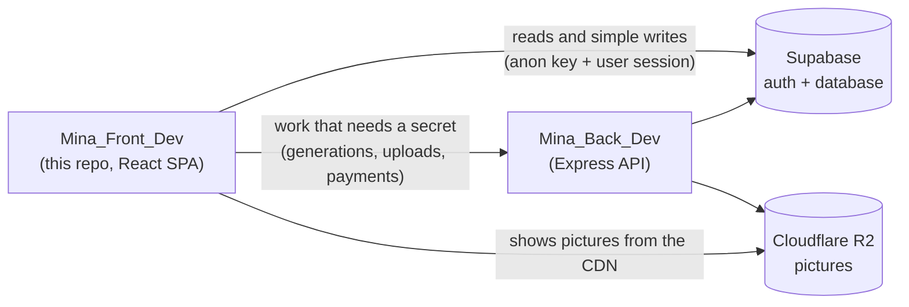

# Mina frontend: start here

Mina is an AI image and video studio for designers. A designer writes a brief, adds pictures (a scene, logos, products), and Mina makes a new picture from them. Every generation costs **matcha**, Mina's credits.

This repo is the web app: a React + Vite + TypeScript single page app. It talks to two things:



- **Supabase directly** for reading data (credits, archive, brand memories, libraries) and small writes the database rules allow (likes, soft delete).
- **The backend API** (`Mina_Back_Dev`) for anything that needs a secret: starting a generation, uploading pictures to R2, Stripe checkout, prompt files.

## Run it

```bash
npm install
```

```bash
npm run dev
```

The app opens on `http://localhost:5173`. Copy [.env.example](../.env.example) to `.env` and fill in these variables (read and checked in [src/config/env.ts](../src/config/env.ts)):

| Variable | What it is |
|---|---|
| `VITE_SUPABASE_URL` | the Supabase project URL |
| `VITE_SUPABASE_ANON_KEY` | the public anon key (never a secret key) |
| `VITE_API_BASE_URL` | where `Mina_Back_Dev` runs; locally `http://localhost:3000` |
| `VITE_APP_ENV` | `development`, `staging` or `production` |

Other scripts: `npm run build` (type-check, then build), `npm run lint` (oxlint).

## Words you'll see everywhere

| Word | Meaning |
|---|---|
| **Matcha** | Mina's credit. A Niche or Creative picture costs 1, a Creative+ picture costs 2. Bought in packs through Stripe. |
| **Create / Animate** | The two studio modes: Create makes a still picture, Animate makes a video (its button is not wired to the backend yet). |
| **Lane** | How a Create picture is made: **Niche** (NanoBanana), **Creative** (GPT Image, about 2K) or **Creative+** (GPT Image, about 4K). |
| **Pills** | The small buttons above the brief: **Scene**, **Logo**, **Product** (each holds uploaded pictures), the lane, the ratio, and the brand memory pill. |
| **Brief** | What the user types. A **locked** passage is a part of it the user pinned. |
| **Mina brief** | The line Mina "types" in place of the brief: while a picture is being made, or to warn about something (pink) or confirm something (green). |
| **Brand memory** | A saved brand asset (logo, illustration, model, product) with up to 5 pictures, reused across generations. Stored as `product` rows. |
| **MMA** | The backend pipeline that turns a brief and pictures into a generation, in 4 steps. See the backend docs. |
| **Archive** | The list of the user's finished generations on the profile page. |

## Reading order

1. [architecture.md](architecture.md): the folders, who may import whom, and how data flows. **Read this first.**
2. The pages, with labelled screenshots and component trees:
   - [pages/home.md](pages/home.md): the login screen
   - [pages/studio.md](pages/studio.md): where generations are made
   - [pages/profile.md](pages/profile.md): the account, brand memory and the archive
   - [pages/auth-callback.md](pages/auth-callback.md): the magic link landing page
3. The features, each followed from the click to the database:
   - [features/create-a-generation.md](features/create-a-generation.md)
   - [features/uploads.md](features/uploads.md)
   - [features/brand-memory.md](features/brand-memory.md)
   - [features/matcha-and-billing.md](features/matcha-and-billing.md)
   - [features/archive.md](features/archive.md)
   - [features/prompt-files.md](features/prompt-files.md)
   - [features/libraries.md](features/libraries.md)
   - [features/accounts.md](features/accounts.md)
   - [features/theming.md](features/theming.md)
4. [reference.md](reference.md): every hook, the service it calls, and what that service hits.

The project's coding rules are in [../CLAUDE.md](../CLAUDE.md). The most important one: **write the least code possible**, and reuse what exists before adding anything.
