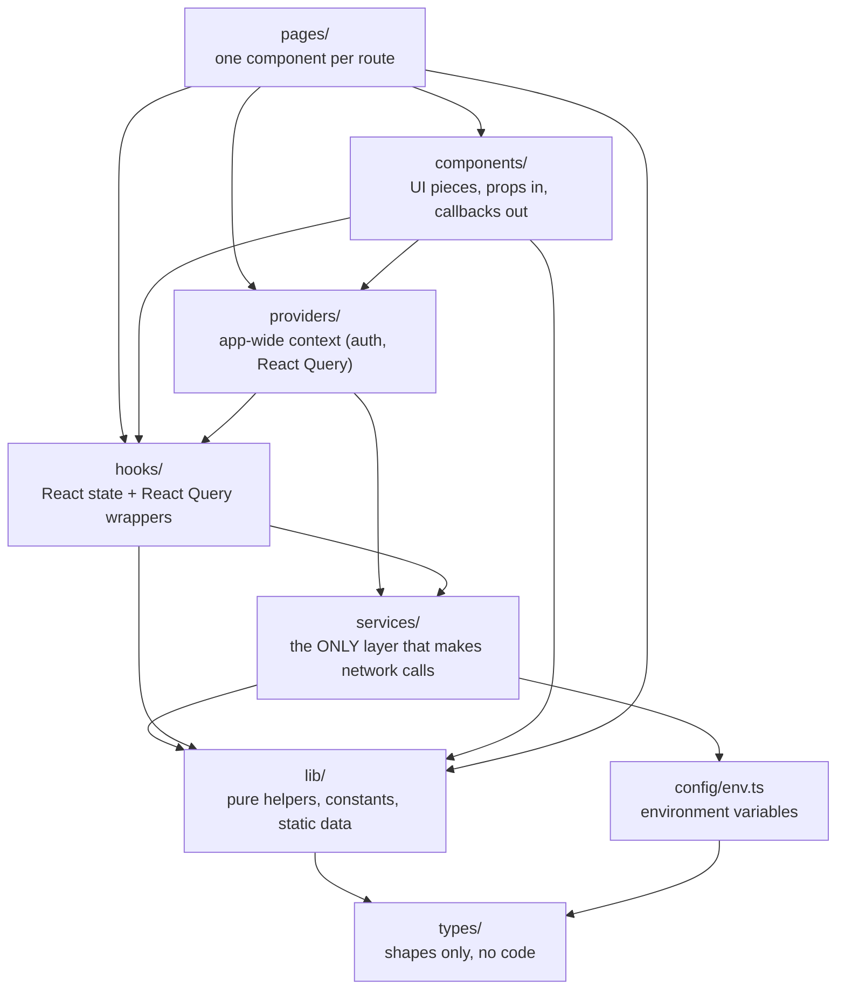
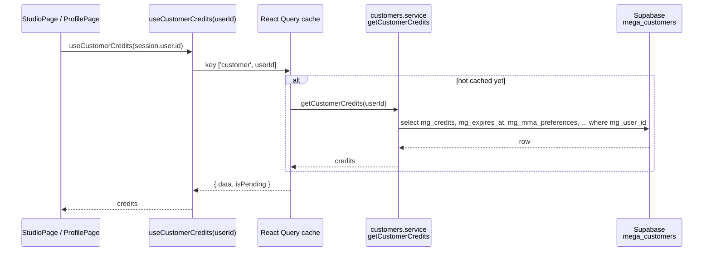
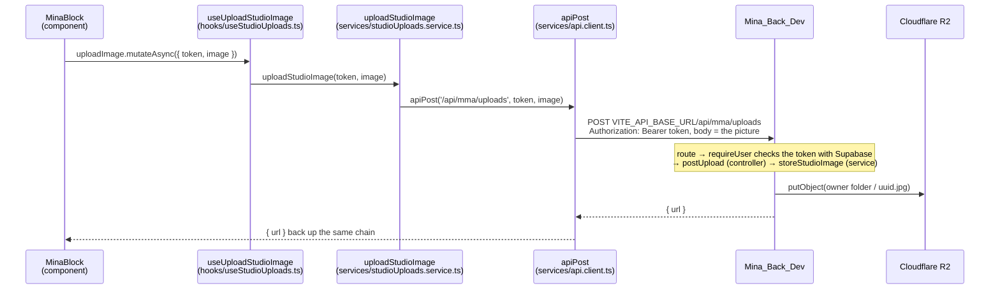
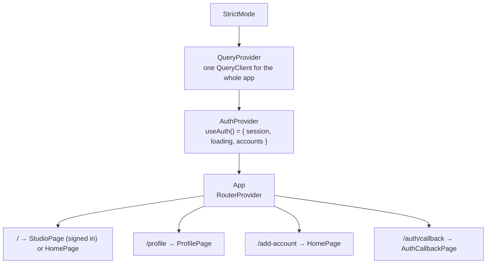
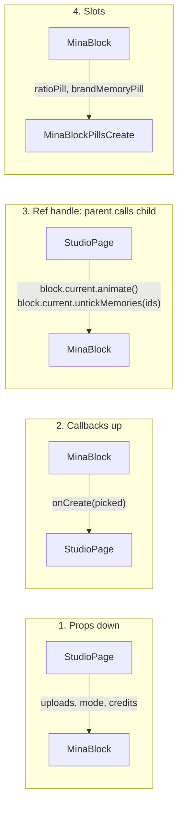

# Architecture

## 1. The folders and who may import whom

Every file in `src/` belongs to one folder, and each folder has one job. Imports only go **downward** in this picture: a page may use a component, a component may use a hook, a hook may use a service, never the other way round.

The two hard rules (from [CLAUDE.md](../CLAUDE.md)):

1. **Never import upward.** A service never imports a hook, a component never imports a page.
2. **Never skip the hook layer.** A component or page never imports from `services/`. If it needs data, it gets a hook.

> One exception exists today: [LoginPanel.tsx](../src/components/LoginPanel.tsx) calls `sendMagicLink` and `signInWithGoogle` from `auth.service` directly. Don't copy that pattern.

| Folder | Put here | Never here |
|---|---|---|
| `pages/` | one component per route, composing components and calling hooks | a `services/` or `supabase` import |
| `components/` | any TSX used in more than one place, or split out to keep a page readable | data fetching |
| `providers/` | context the whole app needs (`AuthProvider`, `QueryProvider`) | context used by one page |
| `hooks/` | `useXxx` logic, one React Query hook per data concern | JSX, raw `fetch` or `supabase` |
| `services/` | every network call: Supabase, the Express API, third parties | React, hooks, state |
| `lib/` | pure functions and static data (constants, formatters, query keys) | anything importing `react` or making a network call |
| `types/` | interfaces and types, re-exported from `types/index.ts` | runtime values |
| `config/` | `env.ts`, the only file allowed to read `import.meta.env` | secrets |

Imports use the `@/` alias for `src/` (`@/components/...`), set in `vite.config.ts` and `tsconfig.json`.

## 2. How a piece of data reaches the screen

Here is one real example, the matcha balance shown in the studio and the profile:

Every piece of server data follows this shape:

- **[hooks/useCustomerCredits.ts](../src/hooks/useCustomerCredits.ts)** wraps `useQuery` with a key from [lib/queryKeys.ts](../src/lib/queryKeys.ts).
- **[services/customers.service.ts](../src/services/customers.service.ts)** does the actual Supabase call, typed in and out.
- When something changes the balance (a generation starts or fails, auto-refill is saved, a Stripe purchase returns), the hook that made the change **invalidates** the key `['customer', userId]`, and every screen using it refetches.

### When the backend is needed

Some work needs a secret the browser can't hold: the R2 keys, the AI keys, Stripe. Then the service calls `Mina_Back_Dev` instead of Supabase. Here is a real example, uploading a picture in the studio:

What changes compared with the Supabase example:

| | Supabase directly | Through the backend |
|---|---|---|
| **Service calls** | `supabase.from(...)` | `apiPost` / `apiDelete` from [api.client.ts](../src/services/api.client.ts) |
| **Who says which user it is** | the Supabase session, checked by the database rules | the `token` (the session's access token), re-checked by the backend's `requireUser` |
| **Hook type** | usually `useQuery` (reading) | usually `useMutation` (doing something), with no cache key |
| **Errors** | Supabase's error, thrown by the service | any non-2xx answer, thrown by `apiRequest` as `"<status> <body>"` |

- **The token** comes from `useAuth().session.access_token`. The component passes it to the hook, which passes it to the service.
- **[api.client.ts](../src/services/api.client.ts)** adds `VITE_API_BASE_URL` and the `Authorization` header to every request. A `Blob` body (a picture) goes up as raw bytes; anything else goes as JSON.

Other calls that take this path:
- `POST /api/mma/still`: start a Create;
- `POST /api/brand-memories`: create a brand memory;
- `POST /api/checkout/session`: Stripe checkout;
- `POST /api/prompt-files/export`: download a prompt file.

The full list is in [reference.md](reference.md). How each route works inside the backend is in `Mina_Back_Dev/docs/api.md`.

### The React Query keys

All keys are built in [lib/queryKeys.ts](../src/lib/queryKeys.ts), so an invalidation can never miss.

**What a key is for.** React Query keeps every piece of server data in a cache, and the key is the name of its slot. Two components asking for the same key share one fetch and one copy of the data, so the balance isn't fetched twice when both the studio and the role tag need it. When the data changes on the server, the code **invalidates** the key: React Query marks the slot as outdated and refetches it for every screen showing it. The user id is part of most keys, so one account's data never shows under another.

**The columns:**
- **Key:** the slot's name, as `queryKeys` builds it (`['customer', userId]` is the balance of that user).
- **Holds:** what data sits in that slot.
- **Filled by:** the hook that fetches the data into the slot (its `useQuery`). Use this hook to read the data; don't call the service yourself.
- **Invalidated by:** what tells React Query that the slot is outdated, so it refetches. This is usually a mutation hook, after it has changed something on the server. If you add a new action that changes this data, invalidate the key there too, or the screen keeps showing the old value.

| Key | Holds | Filled by | Invalidated by |
|---|---|---|---|
| `['customer', userId]` | credits, expiry, auto-refill preferences, role | `useCustomerCredits` | `useStartStillGeneration`, `useGenerationStatus` (on error), `useUpdateAutoRefill`, `ProfilePage` (after `?purchase=success`) |
| `['generations', userId]` | the archive | `useGenerations` | `useStartStillGeneration`, `useGenerationStatus` (on done), `useDeleteGeneration` |
| `['generationStatus', id]` | a running generation's step and picture | `useGenerationStatus` (polls every 5 s) | stops polling at `done` or `error` |
| `['likes', userId]` | the liked generation ids | `useLikedGenerations` | `useLikeGeneration`, `useUnlikeGeneration` |
| `['brandMemories', userId]` | the user's brand memories | `useBrandMemories` | create, update and delete brand memory hooks |
| `['brandMemoryOn', userId]` | the brand memory ON/OFF switch | `useBrandMemoryOn` | `useSetBrandMemoryOn` |
| `['onboardContent']`, `['sceneLibrary']`, `['contentLibrary']`, `['creatorLibrary']` | static content tables | their hooks, `staleTime: Infinity` | never |
| `['rates']` | currency exchange rates | `useExchangeRates`, 1 hour | never |

## 3. Providers: what wraps the app

[main.tsx](../src/main.tsx) nests the providers in this order. Each one needs the one outside it.

- **[QueryProvider](../src/providers/QueryProvider.tsx)** holds the React Query cache. Hooks reach it through `useQueryClient()`.
- **[AuthProvider](../src/providers/AuthProvider.tsx)** reads the Supabase session, listens for sign-in and sign-out, and remembers every account signed in on this browser (for the account switcher). Any file calls `useAuth()` to get `session`, `loading` and `accounts`.
- **[App.tsx](../src/App.tsx)** holds the routes. `/` shows the studio when signed in and the login screen when not: two pages behind one path.

## 4. How components talk to each other

Mina uses four patterns. The diagram shows **one example of each**, not every connection. Every link between two components in the app uses one of these four, and the full list is in the table at the end of this section.

1. **Props down.** The parent passes data. Example: `StudioPage` passes `uploads` to both `MinaBlock` and `RightStudioPanel`, so both show the same pictures.
2. **Callbacks up.** The child reports what happened, and the parent decides. Example: `MinaBlock` calls `onCreate({ uploads, brandMemories })`; `StudioPage` starts the generation.
3. **Ref handles.** When the parent must make the child *do* something, the child exposes methods with `useImperativeHandle`:
   - `MinaBlockHandle` ([types/studio.types.ts](../src/types/studio.types.ts)): `animate()`, `OpenFilePickerScene()`, `removeUpload(url)`, `showScene()`, `untickMemories(ids)`;
   - `MinaBlockUserBriefHandle`: `setupBrief(locked, brief)`, `focus()`.
4. **Slots.** A parent passes a ready-made element as a prop, and the child places it. `MinaBlock` builds the ratio pill and the brand memory pill and hands them to `MinaBlockPillsCreate`, which only decides where they sit.

**Shared state lives in the closest common parent.** The uploads are used by `MinaBlock` (the pills) and `RightStudioPanel` (the carousel), so they're held in `StudioPage` with `useState`.

**App-wide state goes through a provider:** the session, through `useAuth()`.

**Server data goes through React Query:** two components using the same hook and key share one fetch and one cache entry. For example, `MinaBlock` and `ProfilePage` both read the brand memory switch with `useBrandMemoryOn`, without passing anything to each other.

### Every parent → child link

Props are data passed down; callbacks (`on...`) are what the child calls to report back. The page docs draw the same links as diagrams: [home](pages/home.md), [studio](pages/studio.md), [profile](pages/profile.md).

**Home**

| Parent | Child | Props | Callbacks |
|---|---|---|---|
| `HomePage` | `Carousel` | `media` | none |
| `HomePage` | `LoginPanel` | none | none |
| `HomePage` | `TutorialPanel` | none | `onClose` |
| `HomePage` | `LegalPanel` | `title`, `body` | `onClose` |
| `TutorialPanel` | `VideoPlayer` | `src` | none |
| `LegalPanel` | `Markdown` | `source` | none |
| `Carousel` | `GlassDisc` | `x`, `y`, `anchor`, `size`, `tone` | none |

**Studio**

| Parent | Child | Props | Callbacks |
|---|---|---|---|
| `StudioPage` | `MinaBlock` | `mode`, `credits`, `uploads`, `minaStatus`, `ref` (handle) | `onUploads`, `onCreate`, `onNeedMatcha`, `onMinaEnd` |
| `StudioPage` | `RightStudioPanel` | `mode`, `uploads`, `generations` | `onUpload`, `onSetScene`, `onRemove` |
| `StudioPage` | `AppFooter` | `current` | `onOpenMatcha` |
| `StudioPage`, `ProfilePage` | `MatchaPanel` | `isAutoMatchaOn` | `onClose`, `onOpenAutoMatcha` |
| `StudioPage`, `ProfilePage` | `AutoMatchaPanel` | `initialAutoRefill` | `onBack`, `onSaved` |
| `MatchaPanel` | `MatchaSlider` | `stops`, `value` | `onChange` |
| `MinaBlock` | `MinaBlockPillsCreate` | `upload`, `uploads`, `laneLabel`, `ratioPill` (slot), `brandMemoryPill` (slot) | `onSelectUploadKind`, `onOpenFilePicker`, `onNextLane` |
| `MinaBlock` | `MinaBlockPillsAnimate` | `resolution`, `duration`, `ratioPill` (slot) | `onNextResolution`, `onNextDuration` |
| `MinaBlock` | `MinaBlockRatioPill` (as a slot) | `ratioIndex`, `isLandscape` | `onNext`, `onFlip` |
| `MinaBlock` | `MinaBlockBrandMemoryPill` (as a slot) | `ticked`, `dropdown`, `isOff` | `onTick`, `onUntick` (defined in the `useBrandMemoryPicks` hook that `MinaBlock` calls), `onHold` |
| `MinaBlock` | `MinaBlockUserBrief` | `placeholder`, `minaNote`, `nameRanges`, `ref` (handle) | `onClearMinaNote`, `onTextChange` |
| `MinaBlock` | `MinaBlockMinaBrief` | `status` | `onEnd` (passed on from `onMinaEnd`: `endMina`, defined in `StudioPage`) |
| `MinaBlockUserBrief` | `MinaBlockMinaBrief` | `note` | none |
| `MinaBlock` | `MinaBlockUploadAndLibraries` | `title`, `images`, `canAdd`, `library` | `onOpenFilePicker`, `onRemove`, `onMove` |
| `MinaBlock` | `MinaBlockVisionIntelligence` | `isOn` | `onToggle` |
| `MinaBlock` | `MinaBlockCTA` | `label`, `isDisabled`, `isStill` | `onClick` |
| `MinaBlock` | `StudioLibrary` | `library` | `onClose`, `onPickScene` |
| `StudioLibrary` | `SceneLibrary` | none | `onClose`, `onPick` (passed on from `onClose` and `onPickScene`, defined in `MinaBlock`) |
| `StudioLibrary` | `ContentCreatorLibrary` | none | `onClose` (passed on from `onClose`, defined in `MinaBlock`) |
| `SceneLibrary`, `ContentCreatorLibrary` | `CreationMedia` | `url`, `alt`, `motion` | none |
| `RightStudioPanel` | `Carousel` | `media`, `fingertips` (like, download, copy, zoom, delete) | `onIndexChange` |

**Profile**

| Parent | Child | Props | Callbacks |
|---|---|---|---|
| `ProfilePage` | `AccountMenu` | `email`, `currentUserId`, `accounts`, `canAdd`, `error` | `onSwitch`, `onAdd` |
| `ProfilePage` | `BrandMemoryBar` | none (reads its data with hooks) | none |
| `BrandMemoryBar` | `AssetTiles` | `tiles`, `size`, `accept` | `onAdd`, `onCancel`, `onReorder`, each tile's `onClick` / `onLongPress` |
| `BrandMemoryBar` | `BrandingAssetsPanel` | `memory` | `onClose` |
| `BrandingAssetsPanel` | `AssetTiles` | `tiles`, `size` | `onAdd`, `onReorder` |
| `ProfilePage` | `CreationCard` | `generation`, `placement`, `isPanelOpen` | `onTogglePanel`, `onOpen`, `onDownload`, `onDelete` |
| `ProfilePage` | `CreationSkeleton` | `placement` | none |
| `CreationCard` | `CreationMedia` | `url`, `alt`, `motion` | none |
| `CreationCard` | `CreationOtherPanel` | `generation`, `isOpen` (passed on from `isPanelOpen`) | `onToggle` (passed on from `onTogglePanel`, defined in `ProfilePage`) |
| `ProfilePage` | `CreationFullScreen` | `generation` | `onClose`, `onDownload`, `onCopyLink`, `onCopyMedia`, `onNavigate` |
| `CreationFullScreen` | `VideoPlayer`, `GlassDisc` | `src` / `x`, `y`, `size`, `tone` | none |
| `ProfilePage` | `AppFooter` | `current`, `mobileOnly` | none |

**Where a callback is defined.** Unless a row says otherwise, the parent defines the callback itself. "Passed on" means the parent got it as a prop from its own parent and handed it down unchanged, sometimes under a new name. Three components do that: `CreationCard`, `StudioLibrary` and `MinaBlock` (for `onEnd`). Some callbacks defined in `MinaBlock` (`onRemove`, `onMove`, `onPickScene`) call `onUploads` inside them, because the uploads list lives in `StudioPage`.

**Passed on through a card:** `CreationCard` doesn't decide whether its details panel is open. `ProfilePage` keeps the open card's id in `panel` and defines `onTogglePanel` (`setPanel` opens that card, or closes it when it's already open). That keeps only one panel open at a time. `CreationCard` hands both straight to `CreationOtherPanel`, renamed `isOpen` and `onToggle`.

**Used on several pages, with no props:** `RoleTagCard` (reads the role with `useCustomerCredits`), and the builder pieces `Table`, `Row`, `Rule` and `Group`, which only take `className` and children.

## 5. What is kept in the browser

| Where | Key | What | File |
|---|---|---|---|
| `sessionStorage` (this tab only) | `mina.studio` | the brief, locked text, uploads, lane, ratio, the tab's `studioSessionId`, the tab's generated pictures, and the brand memory picks (`brandMemoryPicked`, `brandMemoryDismissed`, `isBrandMemoryGuessQuiet`) | [lib/sessionStorage/studioSession.ts](../src/lib/sessionStorage/studioSession.ts) |
| `localStorage` | `mina-accounts` | every account signed in on this browser (id, email, refresh token, its brand memory switch) | [services/accounts.service.ts](../src/services/accounts.service.ts) |

A refreshed studio tab keeps its brief and pictures. A new tab starts empty, with a new studio session.

## 6. The `lib/` files

| File | Holds | Used by |
|---|---|---|
| [constants.ts](../src/lib/constants.ts) | asset URLs, footer links, matcha packs and rates, hold and drag thresholds | pages, components, `accounts.service` |
| [studio.ts](../src/lib/studio.ts) | everything the studio needs: lanes, ratios, upload kinds and limits, picture preparation settings, Mina's messages, `CREATE_MAX_PICTURES`, `canAffordGeneration` | studio components, `StudioPage`, other `lib/` files |
| [brandMemory.ts](../src/lib/brandMemory.ts) | brand memory constants, recency helpers, `pickBrandMemoryPictures`, `pickCreatePictures` | brand memory components, `MinaBlock`, `useBrandMemories` |
| [brandMemoryDetect.ts](../src/lib/brandMemoryDetect.ts) | finding brand memories in the brief: exact names and Mina's guess | `useBrandMemoryPicks` |
| [brandMemoryImport.ts](../src/lib/brandMemoryImport.ts) | turning dropped files, folders, `.zip` and Shopify CSV into new memories | `BrandMemoryBar` |
| [generations.ts](../src/lib/generations.ts) | reading a generation's row (details, uploads, ratio), archive filters and layout | `ProfilePage`, archive components, `RightStudioPanel` |
| [media.ts](../src/lib/media.ts) | Cloudflare image and video URLs (`cfImage`, `cfVideo`), `prepareStudioImage` (resize and re-encode before upload) | 13 components |
| [minaBrief.ts](../src/lib/minaBrief.ts) | Mina's typed lines while generating, the poll interval | `MinaBlockMinaBrief`, `useGenerations` |
| [queryKeys.ts](../src/lib/queryKeys.ts) | the React Query keys | hooks, `ProfilePage` |
| [sessionStorage/studioSession.ts](../src/lib/sessionStorage/studioSession.ts) | `studioSession.read()` and `.save()` | `StudioPage`, `MinaBlock`, `MinaBlockUserBrief`, `CreationOtherPanel`, `useBrandMemoryPicks` |
| [currency.ts](../src/lib/currency.ts) | the visitor's currency from their time zone, `formatMoney` | the matcha panels |
| [format.ts](../src/lib/format.ts) | dates, durations, Roman numerals | archive and library components |
| [email.ts](../src/lib/email.ts) | email check, webmail link | `LoginPanel` |
| [loadQueue.ts](../src/lib/loadQueue.ts) | at most 12 pictures or videos loading at once | `CreationMedia` |
| [onboardContent.ts](../src/lib/onboardContent.ts) | picking rows from the `onboard_content` table | `HomePage` |

## 7. Styling in one paragraph

Plain CSS, one `.css` file next to each component, class names `mina-<block>__<element>`. Every colour, size and duration comes from a `--mina-*` token in [src/index.css](../src/index.css). Never hard-code a value a token covers. See [features/theming.md](features/theming.md).
