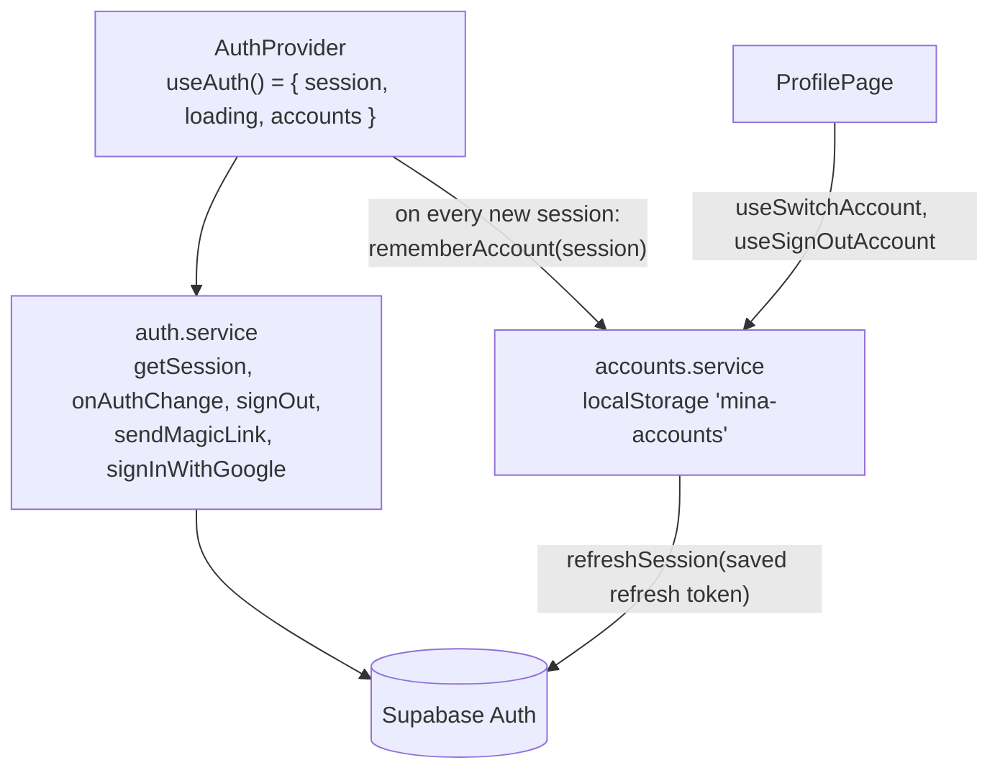

# Sign-in and multiple accounts

A user can be signed in to several Mina accounts on one browser and switch between them from the profile.

## The pieces

- **[AuthProvider](../../src/providers/AuthProvider.tsx)** reads the current Supabase session and listens for changes. Each time a session arrives, it saves that account (id, email, refresh token, its brand memory switch) in `localStorage` under `mina-accounts`, then re-reads the list.
- **[accounts.service.ts](../../src/services/accounts.service.ts)** owns that list, at most 24 accounts (`MAX_ACCOUNTS`).

## Switching, adding, leaving

| User action | What runs |
|---|---|
| **Switch** (pick another email in `AccountMenu`) | `useSwitchAccount`: clears the whole React Query cache, then `supabase.auth.refreshSession` with that account's saved refresh token. If the token has expired, the account is forgotten and the user is told to log in again. |
| **Add another account** | goes to `/add-account` with `state.from` = the current user id. `AddAccountRoute` in [App.tsx](../../src/App.tsx) shows the login screen until a **different** user signs in, then returns to `/`. |
| **Logout** | `useSignOutAccount`: forgets this account, signs it out on this browser only (`scope: 'local'`), then switches to the next saved account, if there is one. |

**Why the cache is cleared on every switch:** every query key includes the user id, but clearing makes sure nothing from the previous account is ever shown, even for a moment.

## First visit of an account

`useAccountSetup` in `StudioPage` creates the `mega_customers` row and asks the backend for the signup matchas. See [matcha-and-billing.md](matcha-and-billing.md#the-first-visit-free-matchas).
