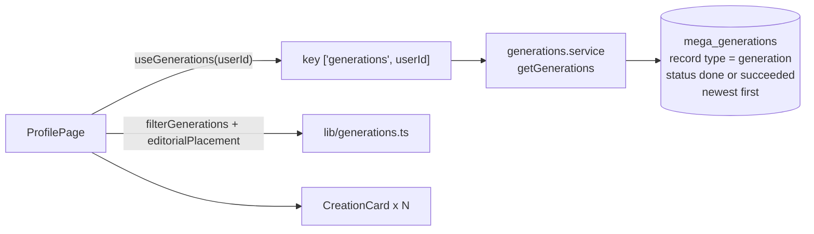

# The archive

The archive is the list of the user's finished generations on the [profile page](../pages/profile.md).

- **Only finished generations show.** Running, failed and deleted ones never appear.
- **The filters** (time, mode, Liked, ratio) and the two layouts (editorial and library) are pure functions in [lib/generations.ts](../../src/lib/generations.ts). Each filter button steps through its list and wraps back to "all".

## What each action does

| Action | Where | Hook → service | What it touches |
|---|---|---|---|
| **Like / Dislike** | details panel, studio carousel | `useLikeGeneration`, `useUnlikeGeneration` | inserts or deletes an `mma_event` row with `mg_meta.event_type = 'like'` |
| **Download** | card, full screen, studio | `useDownloadMedia` → `downloadMedia` | fetches the file as a blob and saves it |
| **Copy picture** | full screen, studio carousel | `useCopyMedia` → `copyMediaToClipboard` | puts a PNG on the clipboard (images only) |
| **Copy link** | details panel, full screen | `useCopyLink` → `copyLink(viewerLinkFor(...))` | a link to `/v?u=...` |
| **Prompt file** | details panel | `useExportPromptFile` | downloads a `.mina` file. See [prompt files](prompt-files.md). |
| **Set scene** | details panel | none: `studioSession.save` + navigate to `/` | the picture becomes the studio's scene |
| **Re-create** | details panel, or click a used picture | none: `recreateOf(generation)` + navigate | the brief, pictures, ratio, brand memories and lane replace the studio's |
| **Delete** | the card's menu button (top right), then confirm | `useDeleteGeneration` → `deleteGeneration` | **soft delete:** sets `mg_status` and `mg_mma_status` to `deleted` and `deleted_since` to now |

## Soft delete

The frontend only marks the row as deleted. The archive hides it because it isn't `done` any more. The backend's daily job deletes the generation's rows 30 days later, and an admin can restore it before then. The pictures themselves are never deleted, because they may have been shared. See the backend's `docs/features/soft-delete.md`.

## The details panel

Every value in [CreationOtherPanel.tsx](../../src/components/CreationOtherPanel.tsx) is read from the generation's `mg_mma_vars` by `detailsOf`, `promptOf` and `uploadsOf` in [lib/generations.ts](../../src/lib/generations.ts):
- `inputs.still_lane`, `inputs.resolution`, `inputs.aspect_ratio`;
- `meta.billing.matchas`;
- `meta.create_asset_plan.items`, the pictures that were sent, grouped by pill.

To show a new value there, read it in `detailsOf`, and make sure the backend writes it into `mg_mma_vars`.
