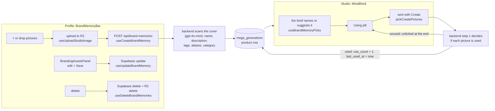
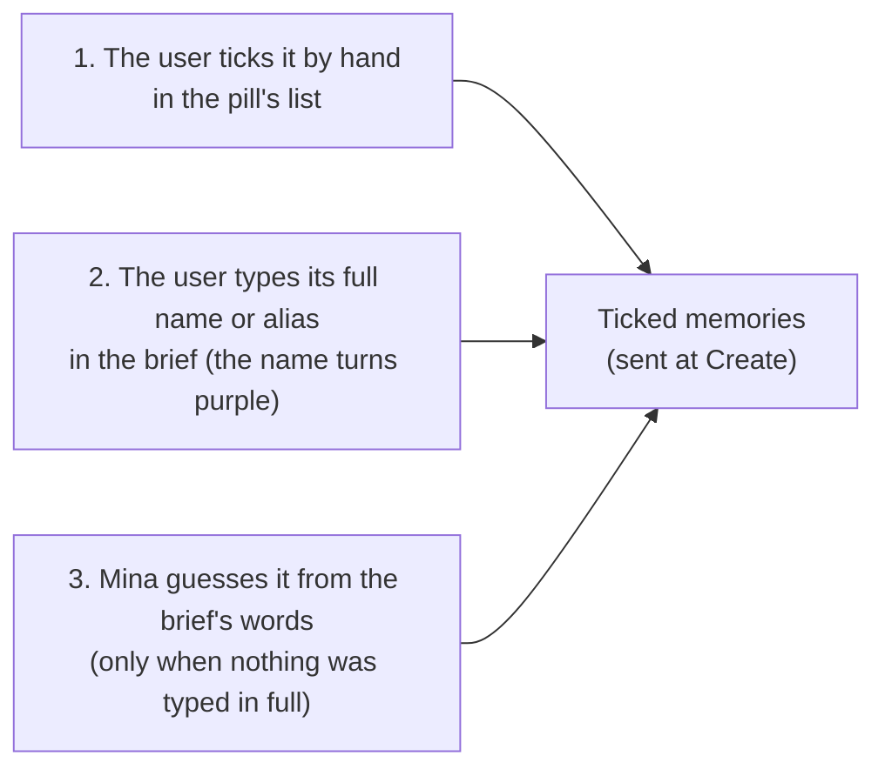
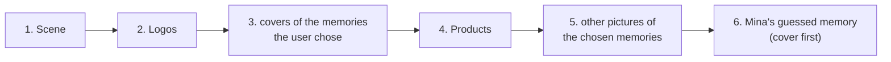

# Brand memory

A brand memory is a brand asset the user saves once and reuses in every Create: a **logo**, an **illustration**, a **model** or a **product**. Each one has up to 5 pictures (the first is the cover), a name, a description, tags and aliases.

In the database it's a row of `mega_generations` with `mg_record_type = 'product'` and `mg_id = 'product:<uuid>'`. Its data is in `mg_mma_vars` (the `BrandMemoryVars` type in [types/brandMemory.types.ts](../../src/types/brandMemory.types.ts)).

## The whole life of a memory

## In the profile

[BrandMemoryBar.tsx](../../src/components/brandMemory/BrandMemoryBar.tsx) shows every memory as a tile, in `recentFirst` order ([lib/brandMemory.ts](../../src/lib/brandMemory.ts)):
- memories used in the last 7 days lead the bar;
- the others follow by `sort_order`;
- memories unused for 30 days are greyed out (`isInactive`).

| Action | What happens | Code |
|---|---|---|
| **"+" with one picture** | prepared like a studio upload, put on R2, then `POST /api/brand-memories`. The backend scans it and writes the row. | `useCreateBrandMemory` |
| **Several pictures, a folder, a `.zip` or a Shopify CSV** | listed under the strip as pending memories (up to 5 pictures each); "Add" uploads them | [lib/brandMemoryImport.ts](../../src/lib/brandMemoryImport.ts) |
| **Drag a tile onto another** | only its `sort_order` changes, to halfway between its new neighbours | `moveMemory`, `useUpdateBrandMemory` |
| **Hold a tile** | select mode: pick several, then delete them together | `useDeleteBrandMemories` |
| **Click a tile** | opens [BrandingAssetsPanel](../../src/components/brandMemory/BrandingAssetsPanel.tsx): pictures, category, name, description | `useUpdateBrandMemory` |

Reading, editing and deleting go **straight to Supabase** from [brandMemory.service.ts](../../src/services/brandMemory.service.ts). Only creating goes through the backend, because the scan needs the OpenAI key.

## In the studio: which memories a Create uses

[hooks/useBrandMemoryPicks.ts](../../src/hooks/useBrandMemoryPicks.ts) works this out on every keystroke, from the cached list, without any network call. It uses `briefBrandMemories` in [lib/brandMemoryDetect.ts](../../src/lib/brandMemoryDetect.ts):

### How brand memories are selected

A memory gets ticked in one of three ways:

**1. By hand.** The user ticks it in the pill's list. It stays ticked whatever the brief says, until the user unticks it.

**2. Full name or alias.** The user types, for example, "Loewe Aqua", or one of its aliases, as whole words in any case. Every memory typed like this is ticked, however many there are.

**3. Mina's guess.** Used only when no name or alias was typed in full. Mina picks **one** memory, the one with the best score:
- Each word of the brief, of at least 3 letters and not a common word like "the" or "with", is looked for at the start of the memory's words.
- The word scores more depending on where it's found: **name 6**, **category 3**, **alias or tag 1.5**, **description 1**. Only the best field counts.
- The score is multiplied by how rare the word is among all the memories: **×2** if only this memory has it, **×1.5** if few have it, **×0.5** if half or more have it. So a word every memory shares hardly counts.
- The memory with the highest total wins. On a tie, the category order decides (logo, illustration, model, product), then the most used, then the most recently used.

The values are in `BRAND_MEMORY_MATCH` ([lib/brandMemory.ts](../../src/lib/brandMemory.ts)). The guessed memory is `guessedId`, sent last at Create (see the order below).

**What stops ways 2 and 3** (ticking by hand always works):
- the memory is disabled (`memory_enabled` is off);
- the user unticked it in this tab, even if its name is typed;
- once the user unticks any memory, Mina stops guessing for the rest of the tab (`isBrandMemoryGuessQuiet`).

The user controls it from the pill's list:
- **Untick** a memory: it's kept out for the rest of the tab, even if its name is typed. It also stops Mina guessing for the rest of the tab.
- **Tick** a memory: it's added whatever the brief says.
- **Hold** the pill: brand memory turns off (the same switch as "Mina vision intelligence" and the profile's Brand Memory ON/OFF). The switch is kept per account in `localStorage`.

These choices are saved in `sessionStorage` (`brandMemoryPicked`, `brandMemoryDismissed`, `isBrandMemoryGuessQuiet`).

**The pill** shows while the brief has text and the user has at least one memory:
- with something ticked, it reads "Using" + the first memory's name, and "+N" for the others;
- with nothing ticked, it reads "+ Pick your branding assets".

## Which pictures are sent: the 14-picture limit

A Create sends at most **14 pictures** (`CREATE_MAX_PICTURES`), uploads and memories together. `pickCreatePictures` in [lib/brandMemory.ts](../../src/lib/brandMemory.ts) fills the places in this order and drops whatever comes last:

As soon as the total goes over 14, Mina says so in pink in the brief, once. Create then sends the first 14 without asking again.

Each memory is sent as `{ id, name, category, images }`. The backend uses `category` to avoid saving a second model, logo or illustration from the pills when a memory of that kind is already in use.

## After the Create

- **The backend** marks every memory step 1 used (`use_count + 1`, `last_used_at = now`). It also saves the pill pictures it used as new memories (`origin: 'create'`).
- **The studio**, once Mina has finished talking, unticks the memories step 1 left out. It reads them from the generation's `mg_mma_vars.meta.product_memory_resolution.unused_ids`, so a forgotten memory isn't sent again with the next Create.
