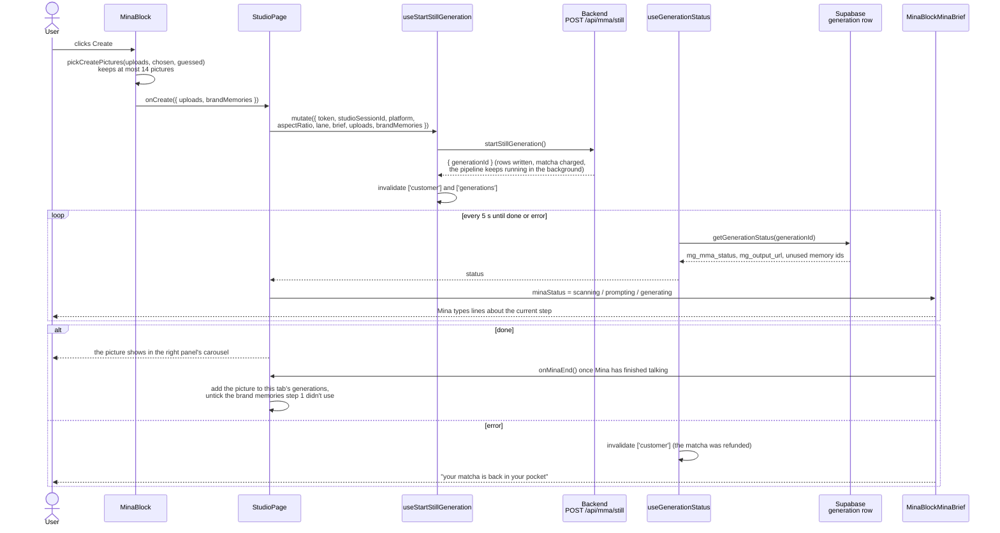

# Create a generation

What happens between a click on **Create** and the new picture in the studio.

## Step by step

1. **The click.** `MinaBlockCTA` calls `onCreate(createPictures)` in [MinaBlock.tsx](../../src/components/studio/MinaBlock.tsx).
   - `createPictures` is worked out on every render by `pickCreatePictures` ([lib/brandMemory.ts](../../src/lib/brandMemory.ts)).
   - It keeps at most 14 pictures (`CREATE_MAX_PICTURES`), in this order: scene, logos, the covers of the memories the user chose, products, those memories' other pictures, then Mina's guessed memory.
   - Above 14, Mina warns in the brief as soon as it happens. See [brand-memory.md](brand-memory.md).
2. **The request.** `create()` in [StudioPage.tsx](../../src/pages/StudioPage.tsx):
   - reads the brief, locked text, lane and ratio from `sessionStorage`;
   - joins the locked text to the brief as its last line;
   - turns the ratio into the engine's `aspectRatio` and the `platform`;
   - calls `useStartStillGeneration`.

   The body is typed in [generations.service.ts](../../src/services/generations.service.ts) (`startStillGeneration`).
3. **The backend** writes the rows, charges the matcha (1 or 2 by lane) and answers with the `generationId` straight away. The four MMA steps then run in the background. Details in the backend's `docs/mma-pipeline.md`.
4. **Polling.** `useGenerationStatus` reads the `generation:<id>` row every 5 seconds (`GENERATION_POLL_MS`) and stops at `done` or `error`.
5. **Mina talks.** While a status is set, `MinaBlock` shows [MinaBlockMinaBrief](../../src/components/studio/MinaBlockMinaBrief.tsx) instead of the brief. It types lines from [lib/minaBrief.ts](../../src/lib/minaBrief.ts) that match each step:

   | `mg_mma_status` | What it means | What Mina says (example) |
   |---|---|---|
   | `progressing` | the request is on its way | "one sec getting everything ready" |
   | `scanning` | step 1 reads the pictures | "reading everything closely..." |
   | `prompting` | steps 2 and 3 write the prompt | "writing your prompt now..." |
   | `generating` | step 4 renders the picture | "almost there" |
   | `done` | the picture is ready | "saved it for you" |
   | `error` | something failed, the matcha was refunded | "...so i gave your matcha back" |

6. **The end.** When Mina has finished her last line, `onMinaEnd` runs `endMina()` in `StudioPage`:
   - the picture joins this tab's `generations` (in `sessionStorage`);
   - the brand memories step 1 didn't use are unticked (`block.current.untickMemories(...)`);
   - the request state resets, so Create works again.

## What a developer should know

- **Clicking Create does nothing in two cases:**
  - **A generation is already running in this tab.** Mina is still working on the previous Create, and `minaStatus` holds its progress. The user waits until it's done before starting a new one.
  - **A picture is still uploading.** Create waits until every picture is on R2, so a generation never starts with a missing picture.

  In both cases the Create button is also greyed out. The check at the start of `create()` in `StudioPage` is a second safety.
- **The balance refreshes twice:** right after the request (the charge), and again on `error` (the refund).
- **The archive refreshes on `done`**, so the profile page already has the new picture.