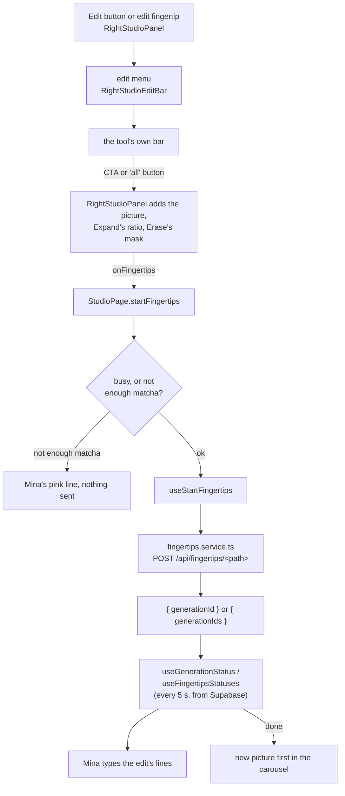

# Fingertips (edit tools)

"Fingertips" are the studio's **edit tools**. They work on a picture that is already in the studio's right panel: a Create's result or an upload. Each edit makes a **new** picture: the original is never changed. The new picture is charged in matchas, shown first in the carousel, and saved in the archive like any other creation.

The backend side (charges, rows, Bria and Replicate) is explained in the backend's `docs/features/fingertips.md`. This page follows the feature from the click to the screen.

## The tools

| Button in the edit menu | What it does | Price | Has an "all" button |
|---|---|---|---|
| **Erase** | Erases the areas the user draws on the picture. | 0.2 matcha | no |
| **Expand** | Grows the picture to a new ratio (2:3, 1:1, 9:16 or 3:4). | 0.1 matcha | no |
| **No Background** | Cuts the subject out on a transparent background. | 0.1 matcha | Remove all BG |
| **No Subject** | Removes the main subject and fills its place. | 0.1 matcha | Remove all Subject |
| **SVG** | Turns the picture into an SVG vector file. | 0.1 matcha | Vectorize All |
| **Prompt** (button **Tweak**) | Changes the picture the way the user's note says. | the lane's price, like a Create (1 or 2) | no |

The "all" button runs the tool on **every** picture of the panel, one charge each. It only shows when the panel has more than one picture.

All of it is configured in [lib/studio.ts](../../src/lib/studio.ts):

| Constant | What it holds |
|---|---|
| `EDIT_TOOL_GROUPS` | the menu's buttons, in groups split by a `\|` |
| `EDIT_TOOL_BARS` | each tool's bar: its call to action label and its optional "all" label |
| `FINGERTIPS_PATHS` | each tool's backend route, `/api/fingertips/<path>` |
| `FINGERTIPS_MATCHAS` | each flat-price tool's price, for the balance check before sending |
| `EDIT_PROMPT_MIN_LENGTH` | Tweak stays disabled until the note is longer than this (3) |
| `ERASE_MAX_AREAS`, `ERASE_ZOOM_MIN`, `ERASE_ZOOM_MAX`, `ERASE_ZOOM_SPEED`, `ERASE_HINT` | Erase's settings (see [Erase](#erase-drawing-the-areas)) |

## From the click to the new picture

### 1. Opening the edit menu

In [RightStudioPanel.tsx](../../src/components/studio/RightStudioPanel.tsx), the **Edit** button of the bar and the **edit fingertip** over the picture both call `edit()`. That sets `editing` to `'menu'`, and also shows the picture whole (`isFitted`) so the user sees all of what they are editing.

`editing` is `null` (the normal bar), `'menu'`, or the name of a tool. While it is set, [RightStudioEditBar.tsx](../../src/components/studio/RightStudioEditBar.tsx) replaces the normal bar. Its back arrow goes from a tool to the menu, and from the menu to the normal bar.

### 2. The tool's bar

Each tool's bar has a back arrow and the call to action (CTA) on the right. Some tools add more:
- **Prompt**: a text input for the note. The CTA (Tweak) is disabled until the note is longer than 3 characters, and the note is cleared once the edit has started.
- **Expand**: the four ratio buttons. The picked ratio, `expandRatio`, is held by the panel, which also draws the Expand frame around the picture in that ratio. The grey around the picture is what Expand will fill.
- **SVG, No Subject, No Background**: the "all" button when there is more than one picture.

Every CTA and "all" button is disabled while Mina is busy (`isBusy`), meaning a Create or another edit is running.

The bar only says which tool was clicked: `onStartEditTool(tool, brief, isAll)`. The panel adds what the bar does not know: the picture on show (`currentUrl`), every picture for an "all" run (`shown`), Expand's ratio, and Erase's mask. Then it calls `onFingertips(...)`, which is `StudioPage.startFingertips`.

### 3. Sending it: `StudioPage.startFingertips`

In [StudioPage.tsx](../../src/pages/StudioPage.tsx):

1. Returns `false` if there is no session or Mina is already busy.
2. Works out the price: `FINGERTIPS_MATCHAS[tool]`, or for Tweak the lane picked in the prompt block. It multiplies by the number of pictures for an "all" run.
3. If the balance is too low, Mina says `NEED_MATCHA_LINE` in pink in the brief and nothing is sent. The backend checks the balance again anyway.
4. Otherwise it calls `startEdit.mutate(...)` with:
   - `imageUrl`, plus `imageUrls` for an "all" run;
   - `brief` (Tweak's note, empty for the others) and `lane`;
   - `aspectRatio`: Expand's picked ratio for Expand, the ratio pill's for the others (only used for the SEO);
   - `platform`;
   - `mask` for Erase.

`useStartFingertips` ([hooks/useFingertips.ts](../../src/hooks/useFingertips.ts)) calls `startFingertips()` in [services/fingertips.service.ts](../../src/services/fingertips.service.ts). That service posts to `/api/fingertips/<FINGERTIPS_PATHS[tool]>`, or to `<path>-all` when `imageUrls` is set. When it succeeds, the hook refetches the balance, since the backend has already charged it.

### 4. Following it

The backend answers at once with the new generation's id, before the edit is done:
- **One picture:** `editId` is followed with `useGenerationStatus`, the same hook a Create uses.
- **"All" run:** `generationIds` are followed with `useFingertipsStatuses`, which polls them all every 5 seconds until each has ended. When they have all ended, it refetches the balance (failed ones were refunded) and the archive.

Both read the generation row's `mg_mma_status` and `mg_output_url` from Supabase.

While an edit runs, `minaFlow` is `'fingertips'`, so Mina's brief uses `FINGERTIPS_LINES` in [lib/minaBrief.ts](../../src/lib/minaBrief.ts). They're the same as a Create's lines except for the start ("got it lets refine that") and Tweak's `prompting` step ("rewriting the prompt around your note"). For an "all" run, Mina follows the first picture still working, then says it is done if at least one picture was made.

### 5. Showing the result

When the status is `done`, the new picture goes **first** in the carousel (`shownGenerations`), so the user sees it at once. For an "all" run, every picture made goes first. Once Mina has finished talking, `endMina()` keeps them in `generations` for good (saved in the tab's session storage) and resets the edit.

If an edit fails, the backend refunds the matchas and no picture is added.

## Erase: drawing the areas

Erase is the one tool with its own picture view: [RightStudioErase.tsx](../../src/components/studio/RightStudioErase.tsx) replaces the carousel while Erase is open. It shows the picture alone and whole, and lets the user draw the areas to erase over it.

| Gesture | What it does |
|---|---|
| Hold the left button and move | draws an area that follows the pointer, closed by a straight line back to its start |
| Draw without Shift | the new area replaces all the others |
| Hold **Shift** while drawing | the new area is added to the others. There are at most 12 (`ERASE_MAX_AREAS`); a 13th drops the oldest. |
| Scroll, or pinch on a touch screen | zooms around the pointer, from 0.5× to 4× |
| Hold **Space** and drag | moves the picture (useful when zoomed in) |
| **Esc** | clears every area. With no area left, it goes back to the edit menu. |

How it is built:
- The areas are an SVG over the picture, with `viewBox="0 0 100 100"`. Each point is stored as a **percentage** of the picture (`ErasePoint`, 0 to 100), so an area keeps its place at any zoom and any screen size.
- The borders are dashed and move all the time (CSS `stroke-dashoffset` animation). Their colours and speed are the tokens `--mina-erase-line`, `--mina-erase-fill` and `--mina-erase-march` in `index.css`.
- Zoom and pan are a CSS `transform` on the picture and its areas together. The wheel listener is added by hand with `{ passive: false }`, because React's `onWheel` cannot stop the page from scrolling.
- A short hint (`ERASE_HINT`) shows over the picture when Erase opens, then fades out after 2.5 s.

### The mask

Bria's Erase needs a **mask**: a picture with the same ratio as the original, **black** where the picture stays and **white** where it must be erased. It is made in the browser, so no API call or extra cost is needed.

Whenever the areas change, `RightStudioErase` calls `generateMask(areas, width, height)` from [lib/studio.ts](../../src/lib/studio.ts):
1. It creates a canvas the size of the picture shown and fills it black.
2. It fills each area in white, turning the percentages back into pixels.
3. It returns the canvas as a PNG data URL.

The mask goes up to the panel through `onMaskChange` (null when there is no area). The panel passes it on when the Erase CTA is clicked, and `StudioPage` sends it as `mask`. The backend stores it in R2 and keeps its URL in the generation's `mg_mma_vars.inputs.mask_image`.

## In the profile

Edits are saved as normal generations, so the archive lists them with everything else. Their row has `mg_mma_mode: "fingertips"`, and [lib/generations.ts](../../src/lib/generations.ts) has two helpers for them:
- `isFingertips(generation)`: true for an edit.
- `beforeEditOf(generation)`: the picture before the edit, read from `mg_mma_vars.inputs.image` with the `FingertipsMmaVars` type ([types/generation.types.ts](../../src/types/generation.types.ts)).

What the profile shows for an edit:

| Where | What | Code |
|---|---|---|
| Card, bottom left | the edit fingertip's icon on a small light disc | `.mina-creation__fingertips` in [CreationCard.css](../../src/components/CreationCard.css) |
| Card, on hover | the picture **before** the edit fades in over the result. CSS only (`.mina-creation:hover`), so there is no hover on phones. | `.mina-creation__before`, [CreationCard.tsx](../../src/components/CreationCard.tsx) |
| Details panel ("more") | **Type** `fingertips` and the real **Matcha** charged (for example 0.2), from `mg_mma_vars.mode` and `meta.billing.matchas`. Mode, Resolution and Ratio have no line, because an edit has no value for them. | [CreationOtherPanel.tsx](../../src/components/CreationOtherPanel.tsx) |

Exporting an edit as a prompt file gives an empty studio for now: an edit's `mg_mma_vars` has none of the keys a prompt file is made from. See [prompt-files.md](prompt-files.md).

## Adding a new edit tool

1. Add its name to `EditTool` in [types/studio.types.ts](../../src/types/studio.types.ts).
2. In `lib/studio.ts`, add it to `EDIT_TOOL_GROUPS` and `EDIT_TOOL_BARS`, and add its path to `FINGERTIPS_PATHS` and its price to `FINGERTIPS_MATCHAS`.
3. If it needs an input the others don't have, like Expand's ratio or Erase's mask, keep it in `RightStudioPanel`, add it to the `onFingertips` call, and send it from `StudioPage.startFingertips`.

The CTA calls every tool the same way, so a new tool with only a picture as input needs no other change.
