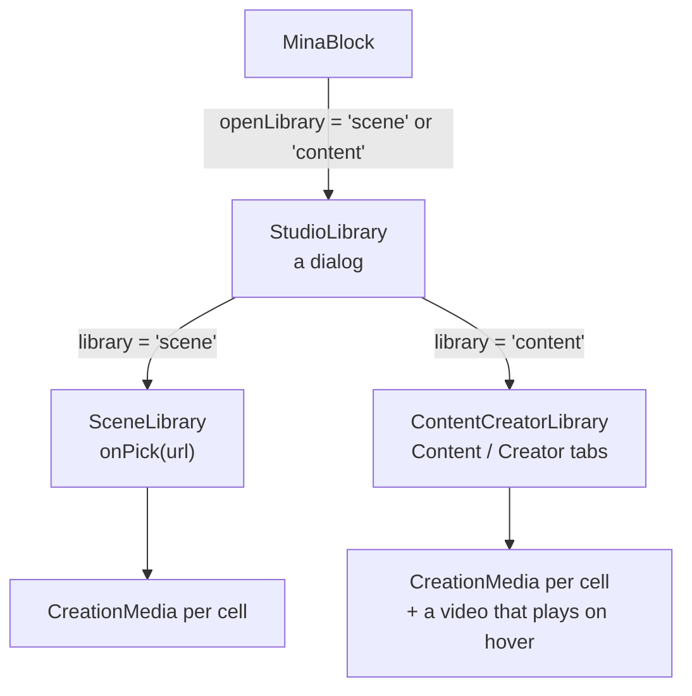
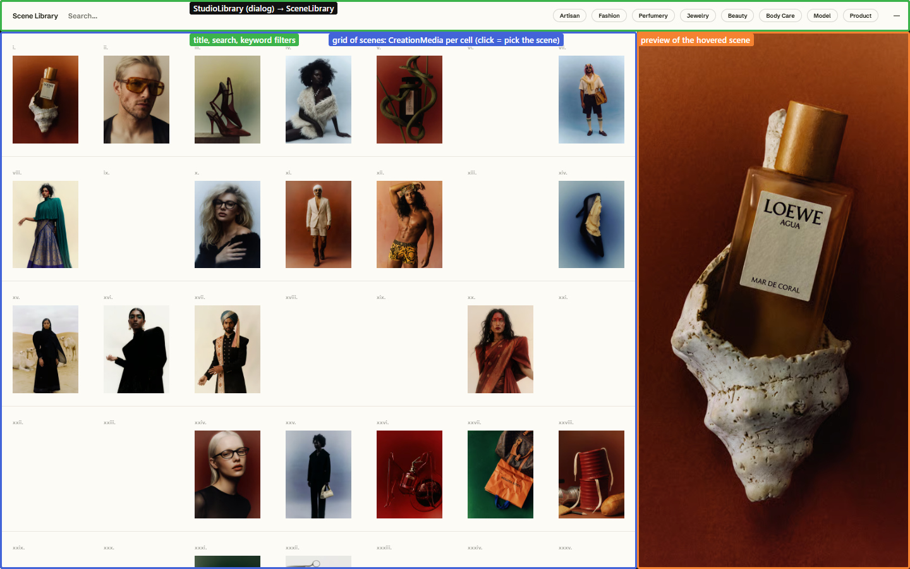
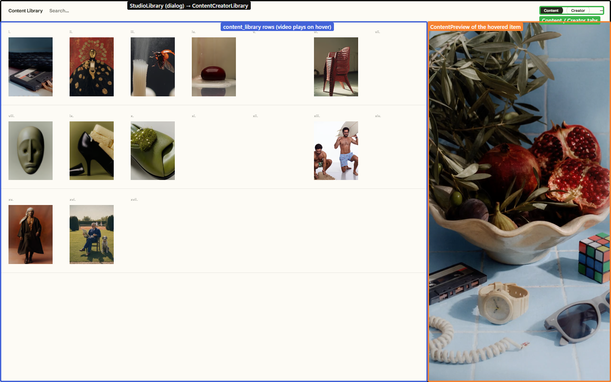

# Libraries

Mina has three ready-made libraries. All three are plain Supabase tables, read straight from the frontend and cached for the whole visit (`staleTime: Infinity`). To change what they show, edit the tables.

| Library | Table | Hook → service | Opened from | Picking one |
|---|---|---|---|---|
| **Scene Library** | `scene_library` | `useSceneLibrary` → `getSceneLibrary` | Create mode, Scene pill's row | becomes the scene upload (`origin: 'scene_library'`) and writes a ready-made brief |
| **Content Library** | `content_library` (`is_active`) | `useContentLibrary` → `getContentLibrary` | Animate mode, the upload row | preview only today |
| **Creators Library** | `creators_library` (`is_active`) | `useCreatorLibrary` → `getCreatorLibrary` | the Creator tab of the Content Library | preview only today |

Both libraries share a layout:
- a search box and keyword filters on top;
- a grid of numbered cells;
- a large preview of the hovered cell on the right.

The Home page's carousel, tutorial and legal texts come from another table, `onboard_content`. See [pages/home.md](../pages/home.md).
