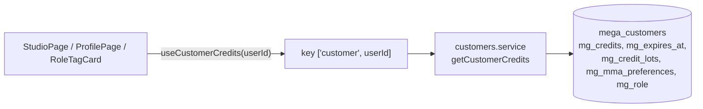
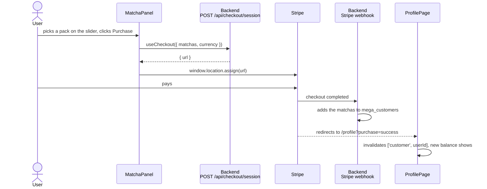

# Matcha and billing

**Matcha** is Mina's credit. The balance lives in `mega_customers.mg_credits`. Every change to it (a charge, a refund, a purchase, an expiry) happens in the **backend**. The frontend only reads the balance and sends the user to Stripe.

## Where the balance comes from

The same query also gives the role (`RoleTagCard` shows "Business" or "Admin") and the auto-refill settings.

**What uses the balance:**
- **The studio** checks it before a Create with `canAffordGeneration` ([lib/studio.ts](../../src/lib/studio.ts)). The cost is the lane's (Niche 1, Creative 1, Creative+ 2). When the balance is too low, the button turns into "I need more matcha" and opens the buy panel.
- **The backend** checks it again before charging, so the frontend check only stops the user early.

## The first visit: free matchas

`useAccountSetup` in [hooks/useAccounts.ts](../../src/hooks/useAccounts.ts) runs once per user in `StudioPage`:
1. `ensureCustomer`: creates the `mega_customers` row, or updates `mg_last_active`.
2. `grantSignupBonus`: `POST /api/credits/signup-bonus`. The backend gives the signup matchas once.

## Buying matcha

- **The packs and their prices in GBP** are in `MATCHA_PACKS` ([lib/constants.ts](../../src/lib/constants.ts)). The backend keeps the same list. The backend's copy is the one that's charged.
- **The visitor's currency** is guessed from their time zone (`currencyForClient` in [lib/currency.ts](../../src/lib/currency.ts)): GBP in London, AED in Dubai, EUR in Europe, USD anywhere else. Prices are converted with `useExchangeRates`, which reads a public rates API once an hour.

## Auto-refill

[AutoMatchaPanel.tsx](../../src/components/AutoMatchaPanel.tsx) saves three settings in `mega_customers.mg_mma_preferences.autoRefill` through `useUpdateAutoRefill`:
- the threshold ("when my matcha is below");
- the pack to buy;
- a monthly spending limit.

The frontend only saves these settings. The backend's auto-refill job checks every 10 minutes and charges the saved card when the balance is under the threshold.

## Invoices

"Invoices" on the profile calls `useBillingPortal` (`POST /api/checkout/portal`), which returns a Stripe billing portal link.

## Matcha in the archive

Each generation's details panel shows what it cost, from `mg_mma_vars.meta.billing.matchas`.
