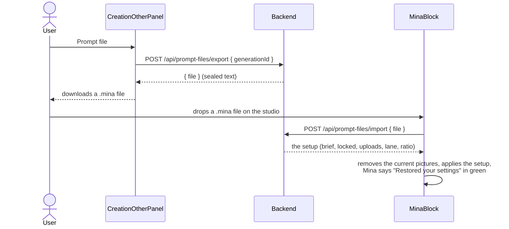

# Prompt files (`.mina`)

A prompt file is a generation's whole setup saved as a file that can be shared: the brief, locked text, pictures, lane and ratio. The backend **seals** it with a key only it holds. Anyone can pass the file around, but only Mina can open it.

- **Export:** `useExportPromptFile` → `exportPromptFile` in [promptFiles.service.ts](../../src/services/promptFiles.service.ts).
- **Import:** `useImportPromptFile`, called by `openPromptFile` in [MinaBlock.tsx](../../src/components/studio/MinaBlock.tsx). `studioSetup()` in [lib/studio.ts](../../src/lib/studio.ts) turns the unsealed inputs into the studio's state. Each piece then saves itself to `sessionStorage`, the same way it does when the user changes it.
- **A file the backend can't open** (edited by hand, or not a Mina file) gives the green line "That .mina file couldn't be read..." (`PROMPT_FILE_LINES.unreadable`). Nothing in the studio changes.
- **The extension** is `PROMPT_FILE_EXTENSION` (`.mina`).

How the file is sealed is in the backend's `docs/features/prompt-files.md`.
