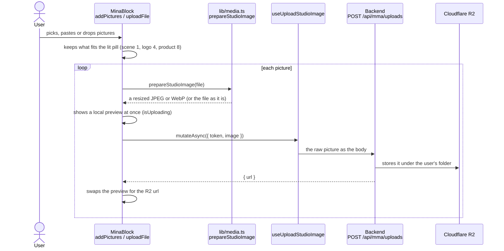

# Uploads

How a picture gets from the user's computer into a pill, and onto Cloudflare R2.

## Three ways in

- **The file picker:** clicking a pill, or "+" in the upload row.
- **Paste or drop:** anywhere on the page, once the block is open in Create mode. A dropped `.mina` file is a [prompt file](prompt-files.md) instead.

All three call `addPictures(files)` in [MinaBlock.tsx](../../src/components/studio/MinaBlock.tsx):
- **For the scene,** the new picture replaces the old one.
- **For logos and products,** only what fits is uploaded, and Mina says so in pink when some didn't fit.

## Preparing the picture

`prepareStudioImage` in [lib/media.ts](../../src/lib/media.ts) uses the settings in `UPLOAD_PREP` ([lib/studio.ts](../../src/lib/studio.ts)):

| Case | What happens |
|---|---|
| over 48 MB | refused, with a message in the brief |
| JPEG, PNG or WebP, at most 2 MB and at most 2160 px on its longest side | sent as it is |
| anything else (bigger, heavier, HEIC, AVIF, GIF...) | redrawn on a canvas, scaled down to 2160 px, saved as JPEG (or WebP when it has transparency) |
| under 300 px | stretched to 512 px, so the AI can read it |

The backend only accepts JPEG, PNG and WebP, so this step is what lets other formats in. HEIC only decodes in Safari.

## Removing a picture

Clicking a picture in the upload row calls `remove(url)`:
- it leaves the list straight away;
- it's also deleted from R2 (`useDeleteStudioImage` → `DELETE /api/mma/uploads`), but only when the user uploaded it and **no Create has sent it yet** (`isSent`). Once a generation used a picture, the picture belongs to that generation and stays.

If the user removes a picture while it's still uploading, the upload finishes and is then deleted.

## Where uploads live

- **The list** is `uploads` in [StudioPage.tsx](../../src/pages/StudioPage.tsx). Each entry is a `StudioUpload` (`kind`, `url`, `origin`, `isUploading`, `isSent`).
- **It's saved in `sessionStorage`** (pictures still uploading are left out), so a refresh keeps the finished ones.
- **`origin`** is `'upload'` for the user's own pictures and `'scene_library'` for a picked scene. Brand memory pictures aren't uploads: they're sent separately (`brandMemories`).
