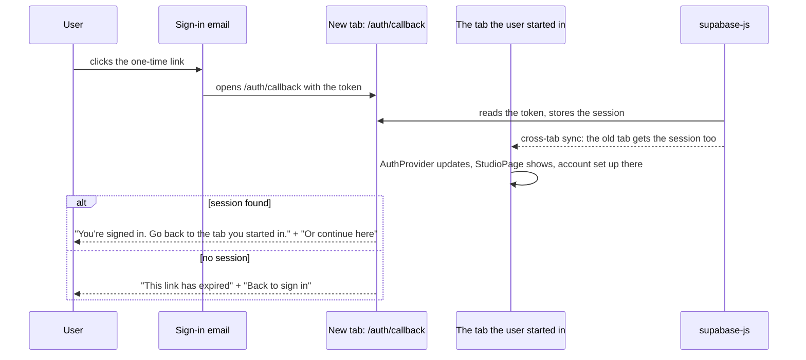

# Auth callback page

**Route:** `/auth/callback`
**File:** [src/pages/AuthCallbackPage.tsx](../../src/pages/AuthCallbackPage.tsx)

This is where the magic link from the sign-in email lands. It has no child components: a logo, a title, a note and a link.

**Why this page does no account setup:** opening the link creates a second tab. The tab the user started in picks up the session through supabase-js's cross-tab sync and does the setup there (`useAccountSetup` in `StudioPage`). If this tab set the account up too, the free signup matchas would be granted twice.

While the session is being read, the page renders empty, so the "expired" message never flashes.

Google sign-in doesn't use this page: it returns straight to `/`.
