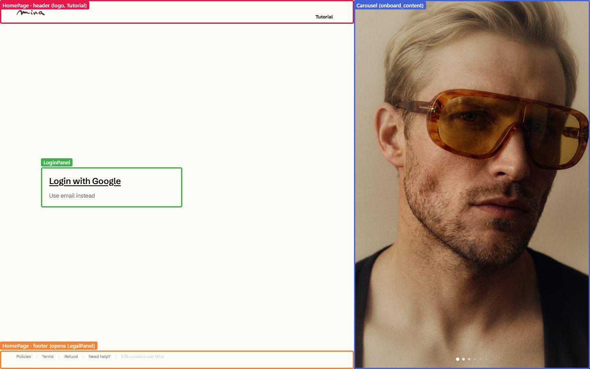
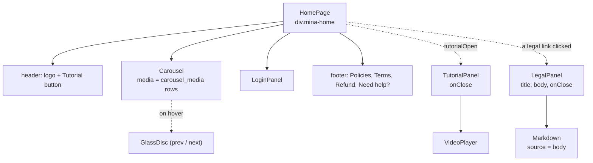
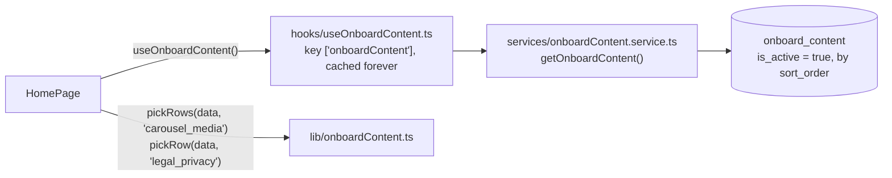
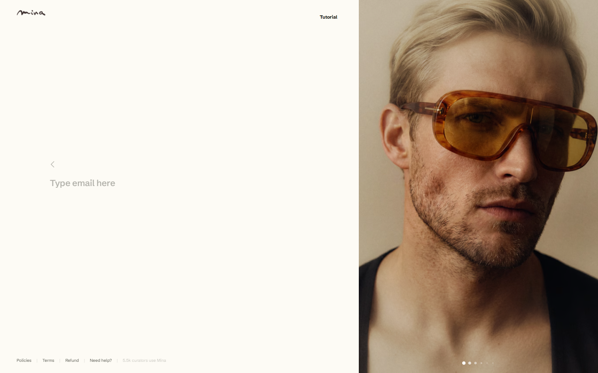
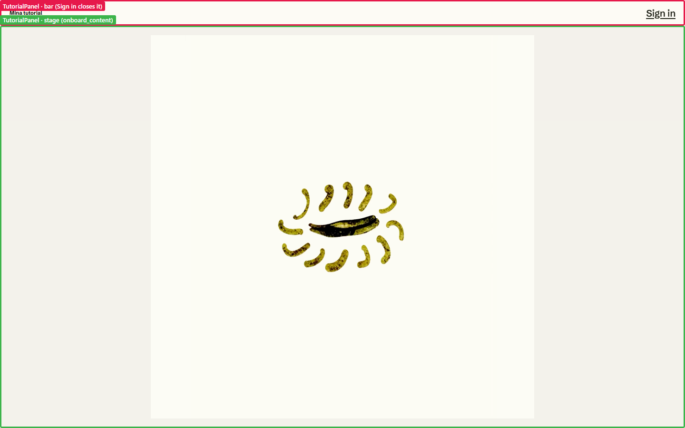
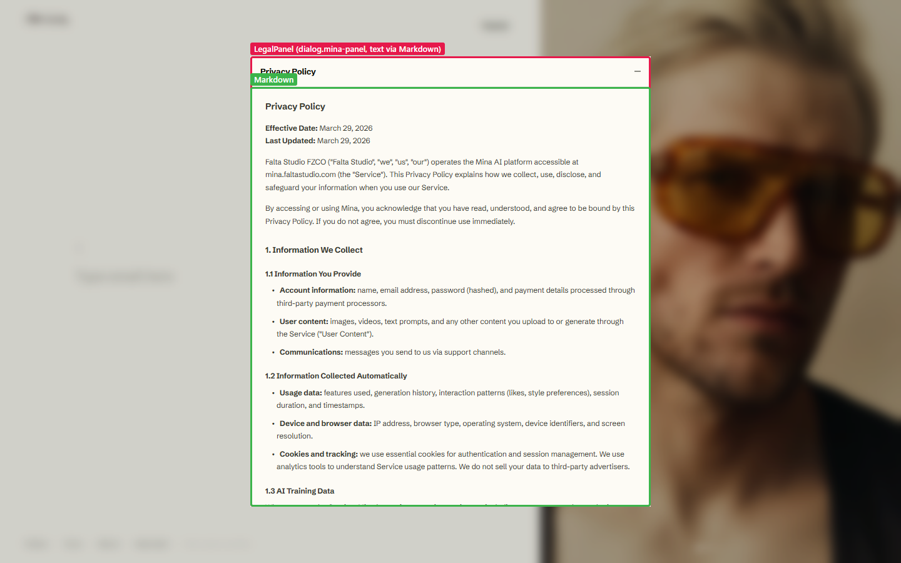

# Home page (the login screen)

**Route:** `/` when signed out, and `/add-account` when adding a second account.
**File:** [src/pages/HomePage.tsx](../../src/pages/HomePage.tsx)

## Component tree

Dotted arrows are rendered only in some states.

## Where the content comes from

Everything on this page except the login buttons comes from one Supabase table, `onboard_content`:

- **The carousel pictures:** the `carousel_media` rows.
- **The Tutorial button label:** from its row, or "Tutorial".
- **The legal texts** (`legal_privacy`, `legal_terms`, `legal_refund`): Markdown, rendered by [Markdown.tsx](../../src/components/Markdown.tsx).

To change any of them, edit the table, not the code.

## Signing in

[LoginPanel.tsx](../../src/components/LoginPanel.tsx) offers two ways:

| Button | Calls | What happens |
|---|---|---|
| Login with Google | `signInWithGoogle()` in [auth.service.ts](../../src/services/auth.service.ts) | Supabase redirects to Google, then back to `/`. |
| Use email instead | `sendMagicLink(email)` | Supabase emails a one-time link that opens [`/auth/callback`](auth-callback.md). |

Once Supabase has a session, `AuthProvider` updates `useAuth().session`, and `RootRoute` in [App.tsx](../../src/App.tsx) swaps this page for the [Studio](studio.md).

## The panels

| Panel | Opened by | Closed by |
|---|---|---|
| [TutorialPanel](../../src/components/TutorialPanel.tsx) | the Tutorial button | Skip, or Sign in |
| [LegalPanel](../../src/components/LegalPanel.tsx) | Policies, Terms or Refund in the footer | the close button, Escape, a click outside |

