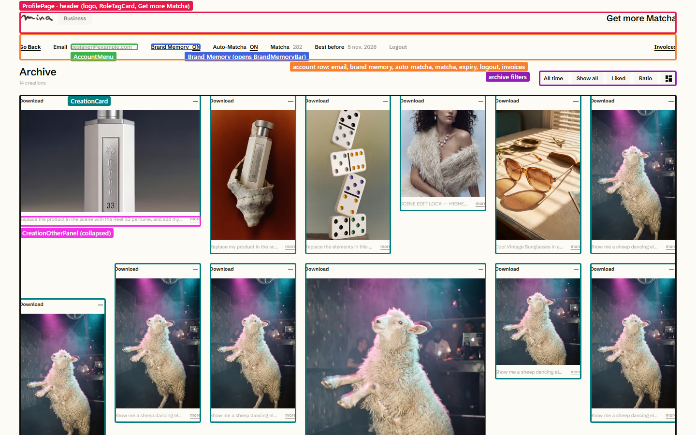
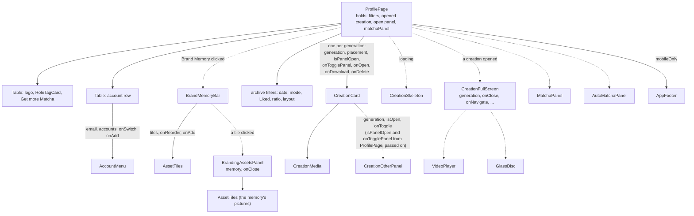
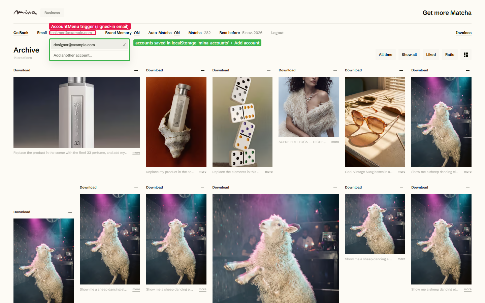
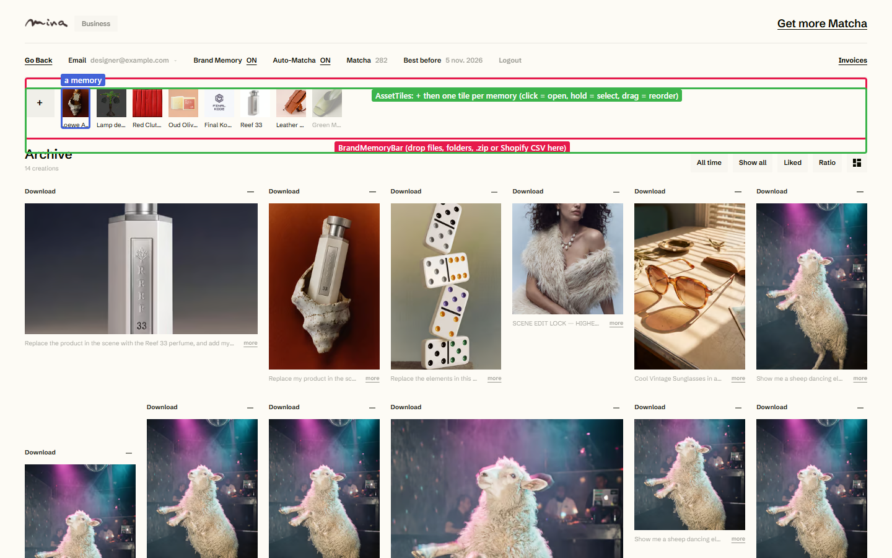
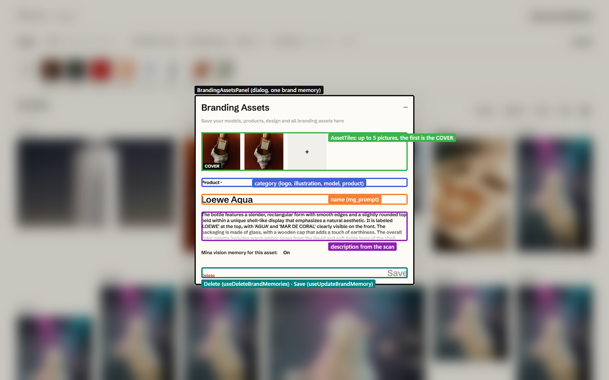
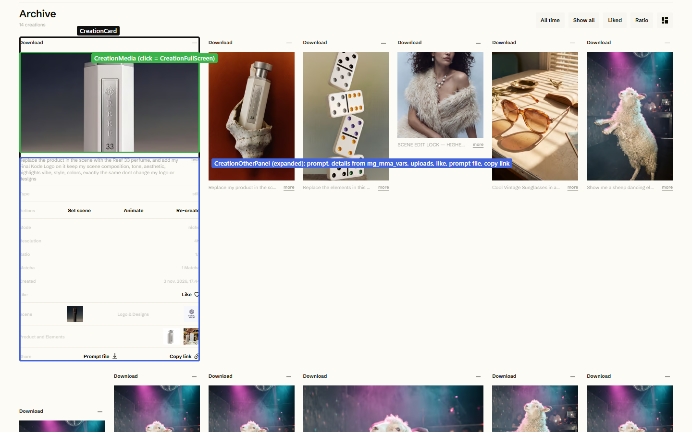
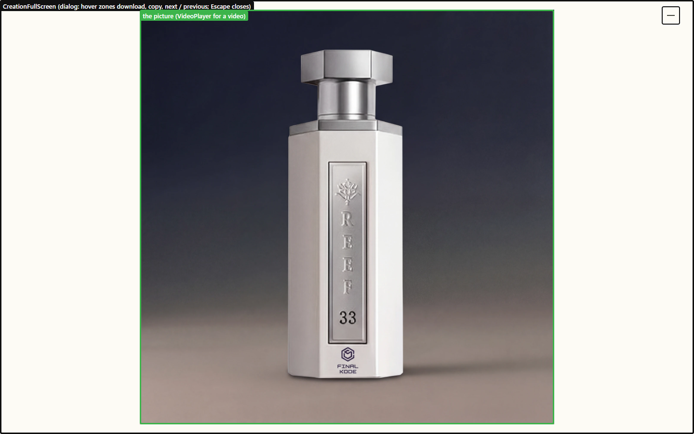

# Profile page

**Route:** `/profile` (sends a signed-out visitor back to `/`).
**File:** [src/pages/ProfilePage.tsx](../../src/pages/ProfilePage.tsx)

The profile has three parts:
- **the account row:** email, brand memory, auto-matcha, balance, logout, invoices;
- **the brand memory bar**, hidden until opened;
- **the archive** of every finished generation.

## Component tree

The page keeps the list state: which filters are on, which card's details panel is open (only one at a time), and which creation is full screen. The cards only report clicks through callbacks.

## The account row

| Item | Does | Through |
|---|---|---|
| Email ▾ (`AccountMenu`) | switch to another account saved on this browser, or add one | `useSwitchAccount`, `/add-account`. See [accounts](../features/accounts.md). |
| Brand Memory / ON | opens the bar below / turns brand memory on or off | `useBrandMemoryOn`, `useSetBrandMemoryOn` |
| Auto-Matcha ON | opens `AutoMatchaPanel` | `useUpdateAutoRefill` |
| Matcha, Best before | balance and when the oldest matchas expire | `useCustomerCredits` |
| Logout | signs out this account only, and switches to the next saved one | `useSignOutAccount` |
| Invoices | opens the Stripe billing portal | `useBillingPortal` |

## Brand memory bar

[BrandMemoryBar.tsx](../../src/components/brandMemory/BrandMemoryBar.tsx) lists every memory as a tile:
- **"+" or a drop:** creates memories (pictures, folders, `.zip` or a Shopify CSV, through `lib/brandMemoryImport.ts`);
- **dragging a tile:** reorders;
- **holding a tile:** selects it, for deleting several at once;
- **clicking a tile:** opens the memory.

[BrandingAssetsPanel.tsx](../../src/components/brandMemory/BrandingAssetsPanel.tsx) edits one memory: its pictures (the first is the cover), category, name and description. Save writes `mg_mma_vars` back to Supabase (`useUpdateBrandMemory`). Delete removes the memory row and its pictures in R2 (`useDeleteBrandMemories`). More in [features/brand-memory.md](../features/brand-memory.md).

## The archive

Every finished generation (`mg_status` and `mg_mma_status` = `done` or `succeeded`), newest first, from `useGenerations`. The filters and the two layouts (editorial and library) are worked out in [lib/generations.ts](../../src/lib/generations.ts).

[CreationOtherPanel.tsx](../../src/components/CreationOtherPanel.tsx) ("more") reads everything from the generation's `mg_mma_vars`:
- the full prompt;
- type, lane, resolution, ratio;
- the matcha it cost (`meta.billing.matchas`);
- the pictures that were used;
- Like, Prompt file and Copy link.

Clicking the picture opens [CreationFullScreen.tsx](../../src/components/CreationFullScreen.tsx):

Each card's menu button (top right) deletes it. That's a soft delete: the row is marked `deleted` and disappears from the list. See [features/archive.md](../features/archive.md).

## Hooks used on this page

`useAuth`, `useQueryClient`, `useSwitchAccount`, `useSignOutAccount`, `useBrandMemoryOn`, `useSetBrandMemoryOn`, `useGenerations`, `useLikedGenerations`, `useCustomerCredits`, `useBillingPortal`, `useDeleteGeneration`, `useDownloadMedia`, `useCopyLink`, `useCopyMedia`. The brand memory components add `useBrandMemories`, `useCreateBrandMemory`, `useUpdateBrandMemory`, `useDeleteBrandMemories`, `useUploadStudioImage`, `useDownloadPicture`.

**After a Stripe purchase,** Stripe sends the user back to `/profile?purchase=success`. The page invalidates `['customer', userId]` so the new balance shows, then removes the parameter from the URL.
