# Studio page

**Route:** `/` when signed in.
**File:** [src/pages/StudioPage.tsx](../../src/pages/StudioPage.tsx)

The studio is where generations are made. On the left, the **MinaBlock** (pills, brief, uploads, the Create button). On the right, the **RightStudioPanel** (a carousel of this tab's pictures).

## What it looks like

When it opens, only the brief shows:

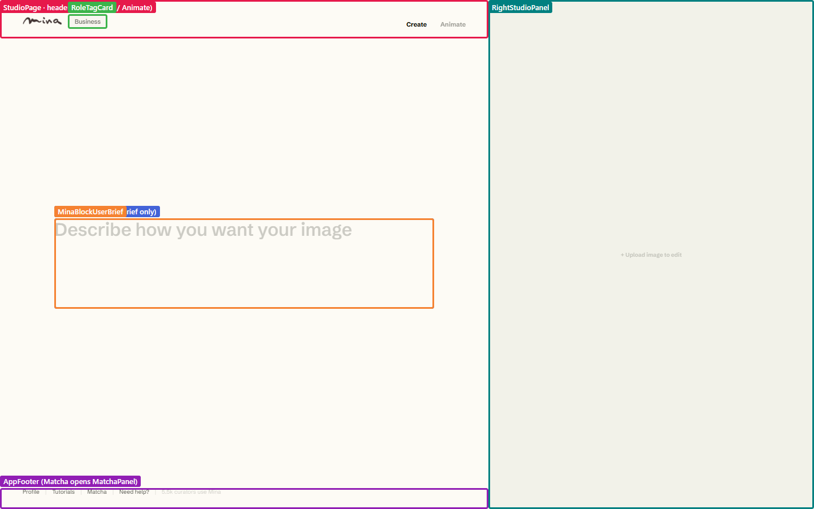

Focusing the brief, or clicking Create or Animate, opens the whole block:

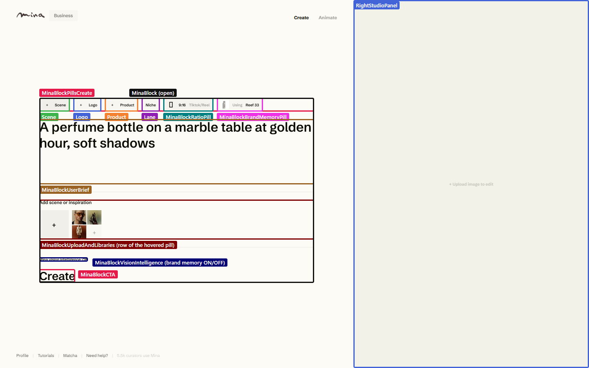

## Page-level tree

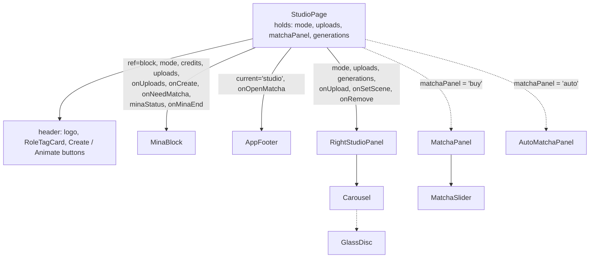

**Why `uploads` lives in `StudioPage`:** both `MinaBlock` (the pills and upload row) and `RightStudioPanel` (the carousel) show them. The page holds them in `useState` and saves them to `sessionStorage` on every change.

**How the page reaches into `MinaBlock`:** through the `block` ref (`MinaBlockHandle`). For example, "+ Upload image to edit" in the right panel calls `block.current.OpenFilePickerScene()`, and "Set Scene" calls `block.current.showScene()`.

## Inside MinaBlock

[src/components/studio/MinaBlock.tsx](../../src/components/studio/MinaBlock.tsx) is the biggest component. It owns everything about the prompt.

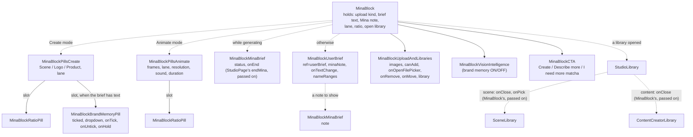

`MinaBlockVisionIntelligence` and `MinaBlockCTA` are small components defined inside `MinaBlock.tsx`.

### The parts

| Part | What it does | Main hooks and lib |
|---|---|---|
| **Scene / Logo / Product pills** | Hovering a pill shows its upload row; clicking it opens the file picker. Limits: scene 1, logo 4, product 8 (`UPLOAD_LIMITS`). | `lib/studio.ts` |
| **Lane pill** | Cycles Niche (1 matcha), Creative (1), Creative+ (2). | `STILL_LANES` |
| **Ratio pill** | A tap cycles the ratio; holding it flips to landscape. | `STUDIO_RATIOS`, `useLongPress` |
| **Brand memory pill** | "Using" + the memories this Create will send. Click to tick or untick; hold to turn brand memory off. See [brand memory](../features/brand-memory.md). | `useBrandMemoryPicks` |
| **Brief** | A textarea, with a mirror under it that draws brand memory names in purple. Selecting text lets the user **lock** it. | `MinaBlockUserBrief` |
| **Mina brief** | The line Mina types in the brief's place: while generating (`status`), or as a note (`warning` in pink, `info` in green). | `lib/minaBrief.ts` |
| **Upload row** | The pictures of the hovered pill: drag to reorder, click to remove. The Scene row also opens the scene library. | `useUploadStudioImage`, `useDeleteStudioImage` |
| **Create button** | Shows "Describe more" while the brief is empty, and "I need more matcha" when the balance is too low. | `canAffordGeneration` |

Everything the user sets (brief, locked text, lane, ratio, uploads, brand memory picks) is saved in `sessionStorage` (`mina.studio`), so a refresh keeps it.

## Brand memory pill and its list

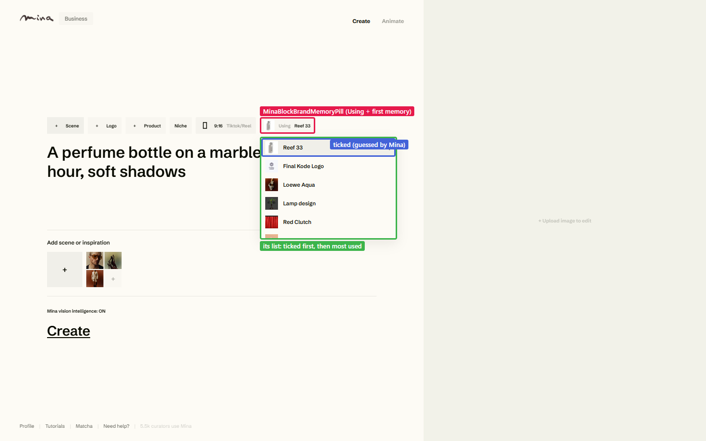

The ticked memories come first, then the rest, most used first. Full details in [features/brand-memory.md](../features/brand-memory.md).

## Picking a scene

The scene library ([SceneLibrary.tsx](../../src/components/studioLibrary/SceneLibrary.tsx)) reads the `scene_library` table:

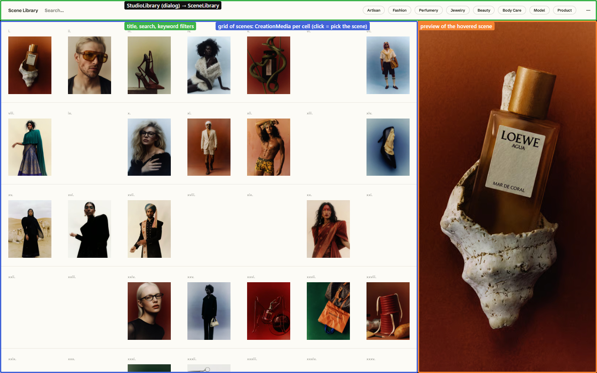

Picking a scene adds it as the scene upload (`origin: 'scene_library'`). It also writes a ready-made brief and locked passage (`SCENE_LIBRARY_BRIEF`) through `userBrief.current.setupBrief()`:

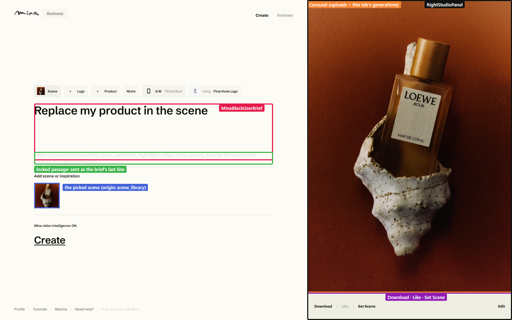

The right panel's carousel now shows the scene. It shows every upload, then this tab's generations. Its actions:
- **Download**;
- **Like** (only for Mina's own pictures);
- **Set Scene** (makes a generated picture the next scene).

## Animate mode

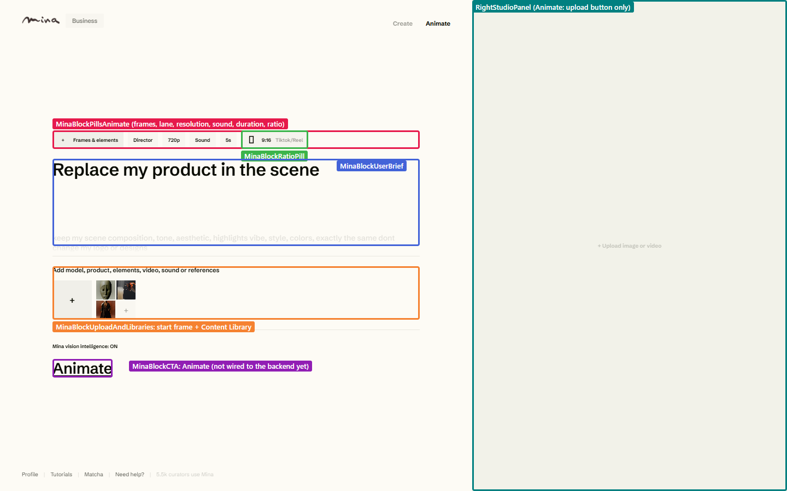

Animate swaps the pills for video settings and opens the **Content Library** instead of the scene library:

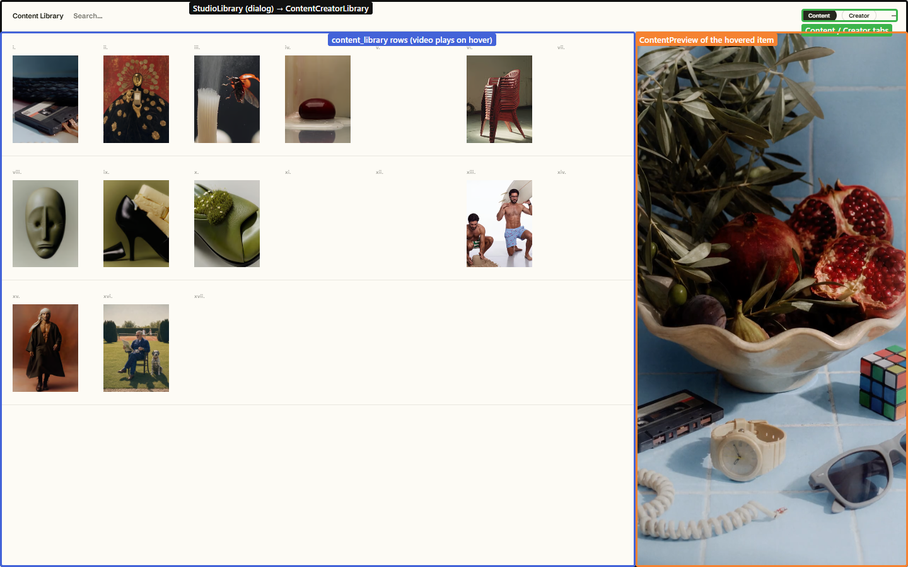

> The Animate button isn't wired to the backend yet: only Create makes generations today.

## The matcha panels

The footer's **Matcha** link, or "I need more matcha", opens the buy panel. Its **Auto-Matcha** link opens the auto-refill panel. See [features/matcha-and-billing.md](../features/matcha-and-billing.md).

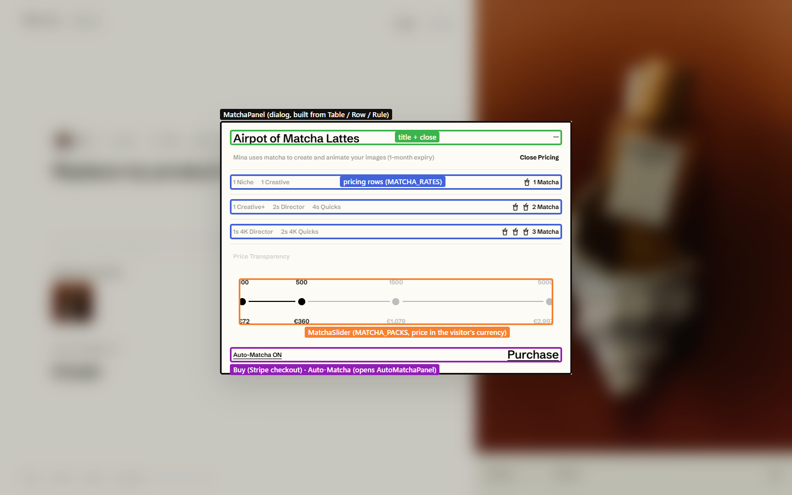

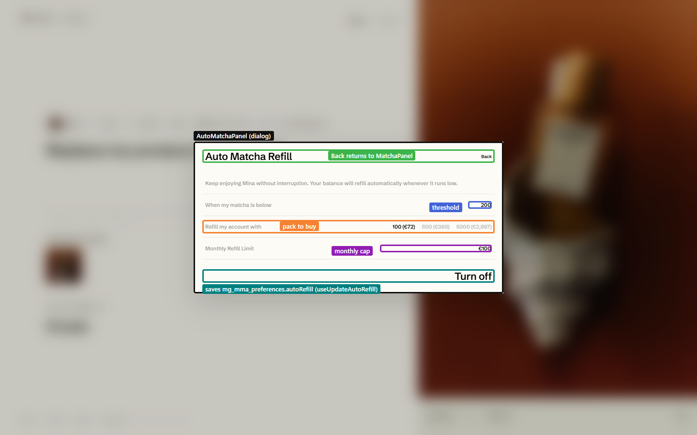

## Hooks used on this page

| Hook | Used in | For |
|---|---|---|
| `useAuth` | page, `MinaBlock`, `RightStudioPanel` | the session and its access token |
| `useAccountSetup` | page | first visit: creates the customer row, grants the signup matchas |
| `useCustomerCredits` | page, `RoleTagCard` | the matcha balance (to show "I need more matcha") |
| `useStartStillGeneration` | page | starts a Create (`POST /api/mma/still`) |
| `useGenerationStatus` | page | polls the running generation every 5 s |
| `useUploadStudioImage`, `useDeleteStudioImage` | `MinaBlock` | pictures to and from R2 |
| `useImportPromptFile` | `MinaBlock` | a dropped `.mina` file |
| `useBrandMemoryOn`, `useSetBrandMemoryOn` | `MinaBlock` | the brand memory switch |
| `useBrandMemoryPicks` | `MinaBlock` | which memories the brief uses |
| `useGenerations`, `useLikedGenerations`, `useLikeGeneration`, `useUnlikeGeneration`, `useDownloadMedia`, `useCopyMedia`, `useCopyLink` | `RightStudioPanel` | the carousel's actions |

How a Create runs, from the click to the picture: [features/create-a-generation.md](../features/create-a-generation.md).
